<picture>
  <source media="(prefers-color-scheme: dark)" srcset="./dark.svg">
  <source media="(prefers-color-scheme: light)" srcset="./light.svg">
  
</picture>

[Portfolio](https://danyal.portfilio.live/) · [LinkedIn](https://linkedin.com/in/danyal-tanveer-30b887320) · [Email](mailto:donibutt2112@gmail.com)

I build web and mobile products with TypeScript and Python, from interfaces and APIs to data models and deployment. I’m a computer science graduate from the University of Central Punjab. During my internship at Tri Tech Technology, I helped build and deploy a multi-tenant point-of-sale system for two restaurants.

## Selected work

### Full-stack and client work

- **[THRIFT for GNZ](https://thrift-for-gnz.vercel.app/)** — A client sneaker storefront and seller portal. Checkout reserves one-of-a-kind inventory in PostgreSQL so two customers can’t buy the same pair.
- **[Restaurant OS](https://github.com/Danyal-0276/POS-backend)** — Three Next.js interfaces and one shared Express API for restaurant operations, with data scoped by restaurant and permissions for five staff roles.
- **[Feastly](https://github.com/Danyal-0276/feastly)** — A delivery marketplace with customer, restaurant, rider, and admin portals, plus Stripe test checkout and live rider tracking.

### Applied AI and mobile

- **[SmishGuard](https://github.com/Danyal-0276/Smish-Gaurd)** — An Android app that explains suspicious SMS messages, with on-device screening and optional model reports. The classifier reached 88.68% phishing recall on a held-out historical test set.
- **[TRAK](https://trak-fyp.netlify.app/)** — My capstone news credibility platform. I worked on fine-tuning RoBERTa and DeBERTa on 220,000+ labeled samples and connecting the models to a React Native app.
- **[Throne of Glass Archive](https://throne-of-glass-rag.vercel.app/)** — An educational fan project with source-linked, streaming answers and spoiler-aware retrieval, built with FastAPI and pgvector.

[More projects](https://danyal.portfilio.live/#work) · [My research on misinformation detection](https://danyal.portfilio.live/#research)

## Languages and tools

  
  
  
  
  
  
  
  
  

- **Languages and markup** — Python, JavaScript, TypeScript, Java, Kotlin, C, C++, SQL, HTML, CSS
- **Web and mobile** — React, Next.js, React Native, Expo, Django REST Framework, FastAPI, Node.js, Express
- **Data and ML** — PostgreSQL, pgvector, MongoDB, Redis, PyTorch, Hugging Face Transformers, scikit-learn

## Contribution heatmap

Snapshot of GitHub contribution data, refreshed manually. Refresh commits are made by GitHub Actions.

Profile maintenance

- **Refresh the heatmap.** Open [Update jet heatmap SVG](https://github.com/Danyal-0276/Danyal-0276/actions/workflows/jet-heatmap.yml), choose **Run workflow** on the default branch, and let the run finish. It commits the SVG only if it changed. There’s no schedule to pause.
- **Rebuild the banners.** Run `python build_profile_svg.py` from the repository root. It reads the committed ASCII portrait and uses only the Python standard library.
- **Replace the portrait.** Install Pillow, then run `python build_profile_svg.py --photo "path/to/portrait.jpg"`. Use `--crop LEFT TOP RIGHT BOTTOM` to frame the subject. Only the ASCII portrait and SVGs are saved.

Language logos from [Devicon](https://github.com/devicons/devicon).

