<picture>
  <source media="(prefers-color-scheme: dark)" srcset="./dark.svg">
  <source media="(prefers-color-scheme: light)" srcset="./light.svg">
  
</picture>

  I’m a computer science graduate from the University of Central Punjab. 
  I build web and mobile products, from restaurant software to applied AI tools.

  
  &nbsp;&nbsp;&nbsp;
  
  &nbsp;&nbsp;&nbsp;
  

<h2 align="center">Languages</h2>

  
  &nbsp;&nbsp;&nbsp;
  
  &nbsp;&nbsp;&nbsp;
  
  &nbsp;&nbsp;&nbsp;
  
  &nbsp;&nbsp;&nbsp;
  

  
  &nbsp;&nbsp;&nbsp;
  
  &nbsp;&nbsp;&nbsp;
  
  &nbsp;&nbsp;&nbsp;
  
  &nbsp;&nbsp;&nbsp;
  

<h2 align="center">Selected work</h2>

  <a href="https://thrift-for-gnz.vercel.app/">THRIFT for GNZ</a>
  &nbsp;·&nbsp;
  <a href="https://github.com/Danyal-0276/Smish-Gaurd">SmishGuard</a>
  &nbsp;·&nbsp;
  <a href="https://trak-fyp.netlify.app/">TRAK</a>

## Contribution heatmap

Snapshot of GitHub contribution data, refreshed manually by GitHub Actions.

Profile maintenance

- Open [Update jet heatmap SVG](https://github.com/Danyal-0276/Danyal-0276/actions/workflows/jet-heatmap.yml) and choose **Run workflow** on the default branch. GitHub Actions commits the SVG when it changes.
- Run `python build_profile_svg.py` to rebuild the banners. To replace the portrait, install Pillow and add `--photo "path/to/portrait.jpg"` and optionally `--crop LEFT TOP RIGHT BOTTOM`.

Logos from [Devicon](https://github.com/devicons/devicon).

